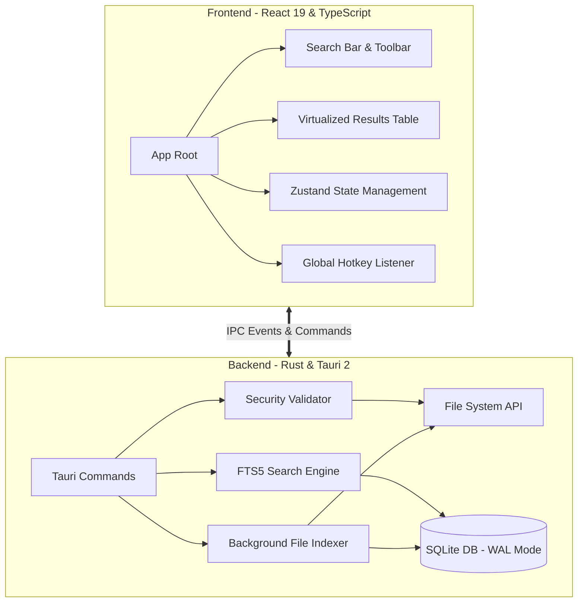

# Vexil Search 🔍

Vexil Search is a blazing-fast, privacy-first desktop file search application built with Tauri 2, React 19, and Rust. It leverages local AI embedding models and SQLite's FTS5 engine to provide instant, semantic full-text search capabilities across your local filesystem—without ever sending your private data to the cloud.

---

## 🏗️ System Architecture

---

## 📐 Software Architect Perspective

**Architecture Patterns & System Design:**

- **Hybrid Desktop Architecture:** Utilizes Tauri 2 to maintain a thin, web-based presentation layer (React) while offloading heavy computations, file system monitoring, and database operations to a highly performant systems language (Rust).
- **High-Performance Storage:** Uses `rusqlite` with `r2d2` connection pooling. The database operates in Write-Ahead Logging (WAL) mode to allow concurrent reads from the UI while the background indexer continuously writes updates.
- **Advanced Full-Text Search:** Implements SQLite's FTS5 extension using a `trigram` tokenizer. This allows for rapid partial-string and substring matching without being constrained by language-specific stemming rules (unlike the `porter` tokenizer), guaranteeing high recall for file paths and code snippets.
- **Security-First Boundary:** Implements a strict `AllowedRoots` path validation system to prevent path traversal attacks during file deletion or indexing operations.

**Scalability & Resilience:**

- **Asynchronous Indexing:** File indexing operates in a dedicated background thread, chunking database inserts in batches of 500 to optimize transaction overhead and prevent locking the main thread.
- **Virtualized Rendering:** The frontend utilizes `@tanstack/react-virtual` to seamlessly render tens of thousands of search results in the DOM without degrading memory or frame rates.

---

## 💻 Software Developer Perspective

**Code Structure & Implementation:**

- **Backend Modularization:** The Rust backend is cleanly separated into `lib.rs` (Tauri commands and lifecycle), `db.rs` (database initialization and schema), and `security.rs` (path traversal protections).
- **State Management:** Extracted complex React state into a global `Zustand` store (`useSearchStore`), reducing prop drilling and mitigating React StrictMode lifecycle complexities.
- **Responsive IPC:** Communication between Rust and TypeScript relies heavily on Tauri's IPC event system (`emit` and `listen`), particularly for streaming indexing progress (`indexing-progress` and `indexing-done`) to the frontend in real-time.

**Maintainability:**

- **Strict Typing:** Strong TypeScript interfaces map directly to Rust structs (e.g., `SearchResult`), preventing runtime serialization errors.
- **Linting & Formatting:** Enforced via Husky, ESLint, and Prettier to ensure consistent code styling.

---

## 🚀 Product Manager Perspective

**Core Features & Usability:**

- **Global Accessibility:** Bound to a global hotkey (e.g., Cmd/Ctrl+Shift+Space), allowing users to summon the search interface instantly from anywhere in the OS without breaking their flow.
- **"Live Radar" Notifications:** Non-intrusive toast notifications alert users of background indexing events (like new downloads), keeping them informed of system state without stealing focus.
- **Lightning Fast UX:** Typo-tolerant and instant search results with highlighted snippets mean users find what they need in milliseconds. The native desktop "feel" (no transparent backgrounds, solid native window decorations) matches user expectations for an OS-level tool.

**Alignment with Business Goals:**

- **Privacy by Design:** 100% local processing. No data leaves the machine, catering to enterprise security requirements and privacy-conscious power users.
- **Resource Efficiency:** By choosing Tauri over Electron, the application consumes a fraction of the RAM and CPU, avoiding the "heavy electron app" stigma.

---

## 🔮 Actionable Insights & Next Steps

1. **Implement `tracing` for Observability:** Replace standard `println!` logging with the `tracing` crate to capture structured logs. This will be invaluable for debugging user environments and tracking FTS5 query performance.
2. **File System Watcher (`notify`):** The current indexing model relies on polling/manual triggers. Integrating a continuous `notify` watcher for the `Documents` and `Downloads` folders will ensure the index is always up-to-date without requiring a full re-scan.
3. **Debounce Optimization:** While the frontend debounces search queries, rapid typing can still queue multiple heavy IPC calls. Consider adding cancellation tokens to abort in-flight database queries when a new keystroke occurs.
4. **Result Ranking Tuning:** The current BM25 clamping logic (`100.0 / (1.0 + bm25.abs() * 0.15)`) may need A/B testing with real user queries to ensure the most relevant files (e.g., exact title matches vs. deep content matches) surface to the top consistently.
